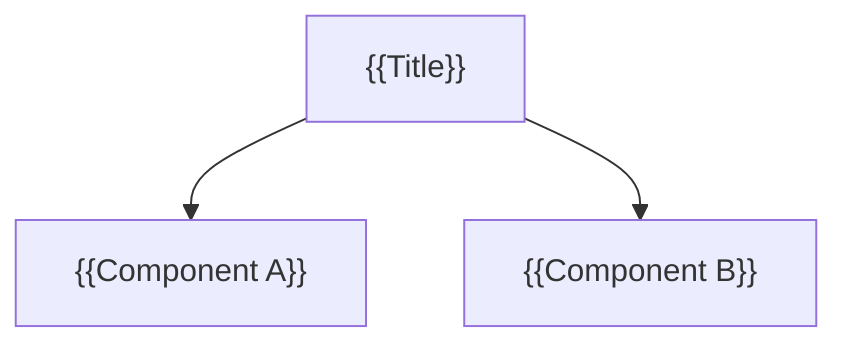

# {{Title}}

> {{One-to-two sentence description — the elevator pitch.}}

## Details

{{Elaborated explanation: motivation/problem, proposed approach, key
assumptions, non-goals, and any open questions still unresolved.}}

## Graph



## Data Model

> Proposed SQLite schema (proposal only; not yet created). Used by the
> create-skill to write database queries. Write "No persistent data model"
> if not applicable.

### `{{table_name}}`

{{Purpose of the table / entity.}}

| Column | Type | Constraints | Description |
| --- | --- | --- | --- |
| `id` | INTEGER | PRIMARY KEY AUTOINCREMENT | Surrogate key |
| `{{column}}` | {{TEXT/INTEGER/REAL/BLOB}} | {{NOT NULL, UNIQUE, DEFAULT ...}} | {{meaning}} |
| `{{other_table}}_id` | INTEGER | NOT NULL, FK → `{{other_table}}(id)` | {{relationship}} |
| `created_at` | TEXT | NOT NULL DEFAULT CURRENT_TIMESTAMP | ISO-8601 timestamp |

**Indexes:** {{e.g. `idx_{{table_name}}_{{column}}` on (`{{column}}`)}}

**Enumerations:** {{e.g. `status` ∈ `draft | active | archived`}}

### Relationships

```mermaid
erDiagram
    {{TABLE_A}} ||--o{ {{TABLE_B}} : "{{has}}"
    {{TABLE_A}} {
        INTEGER id PK
        TEXT {{column}}
    }
    {{TABLE_B}} {
        INTEGER id PK
        INTEGER {{table_a}}_id FK
    }
```

## Related

- [[Idea Index]]
