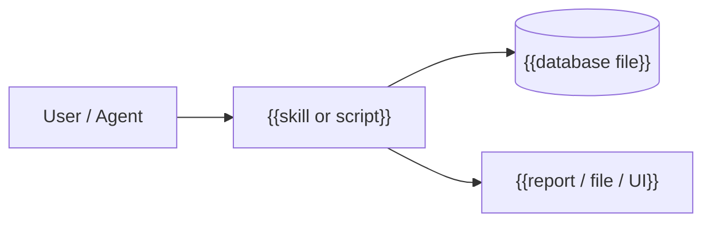

# {{Idea Title}} - System Design

> {{What the system does and the main design choice, in two sentences.}}

## Components

| Component | Responsibility | Location |
| --- | --- | --- |
| {{name}} | {{what it does}} | {{path or table}} |

## Architecture



## Data model

Final schema as implemented. Source of truth is the live database.

### `{{table_name}}`

{{Purpose.}}

| Column | Type | Constraints | Description |
| --- | --- | --- | --- |
| `id` | INTEGER | PRIMARY KEY AUTOINCREMENT | Surrogate key |

**Indexes:** {{list}}

**Enumerations:** {{list}}

```mermaid
erDiagram
    {{TABLE_A}} ||--o{ {{TABLE_B}} : "{{has}}"
```

## Interfaces

| Interface | Trigger | Inputs | Outputs |
| --- | --- | --- | --- |
| {{skill / script / command}} | {{prompt or command}} | {{inputs}} | {{outputs}} |

## Dependencies

| Dependency | Version | Why |
| --- | --- | --- |
| {{package}} | {{version}} | {{reason}} |

## Security and privacy

- {{sensitive data handled, redaction, read-only rules}}

## Deviations from the idea

- {{None, or what changed and why; link the ADR.}}

## Related

- [[Ideas/{{Idea Title}}|Idea]]
- [[Projects/{{Idea Title}}/{{Idea Title}}|Overview]]
- [[Decisions]]
