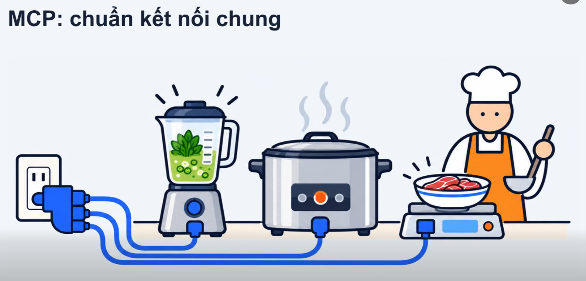
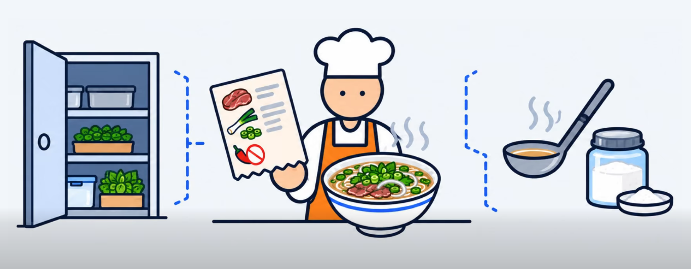

# AI Agent skills & tools

Từ chatbot thụ động đến tác nhân biết hành động

---
layout: default
---

# Vì sao LLM cần kỹ năng và công cụ?

Bản thân AI giống như một chuyên gia bị nhốt trong phòng kín: rất giỏi nói chuyện và suy luận, nhưng không biết chuyện đang xảy ra bên ngoài và không tự tay làm việc được.

#### 01 · Không biết dữ liệu chuyên biệt và mới nhất

AI không tự biết giá vàng hôm nay hay doanh thu tháng này trong file Excel của công ty bạn.

#### 02 · Chỉ nói chứ không tự làm được

AI có thể soạn giúp bạn một bức thư hay, nhưng không tự bấm nút gửi email hay sửa ảnh trong máy.

#### 03 · Dễ  thực hiện sai những việc cần độ chính xác

Tính toán hóa đơn hàng trăm dòng rất dễ nhầm; giao cho máy tính hoặc phần mềm chạy sẽ chuẩn 100%.

#### Giải pháp

Trang bị **Công cụ** (để có thể thao tác) và **Kỹ năng** (sổ tay hướng dẫn cách làm).

---

# Công cụ AI và MCP

## Công cụ (Tool) là gì?

Là những phần mềm hoặc chức năng bên ngoài mà AI được phép nhờ làm hộ.

**Ví dụ:** Công cụ tra thời tiết, máy tính bỏ túi, lệnh đọc cơ sở dữ liệu, hoặc phần mềm chỉnh ảnh GIMP.

## MCP là gì?

Là "cổng kết nối vạn năng" (như cổng USB-C) giúp AI truy cập vào là dùng được nhiều phần mềm khác nhau theo cùng một chuẩn.

**Ví dụ:** Nhờ MCP, cùng một AI có thể nối với cả Google Drive, Slack lẫn GIMP mà không cần hướng dẫn lại.

Thay vì mỗi phần mềm một kiểu kết nối, tất cả đi qua chuẩn chung: <b>AI Agent ↔ MCP ↔ Phần mềm</b>

---

# Ví dụ công cụ: MCP điều khiển GIMP

<video src="./media/MCPImageEditor.mp4" class="mx-auto mt-4 h-96 rounded" controls muted loop autoplay></video>

---

# Chu trình sử dụng công cụ

Mô hình AI (LLM) không tự chạy phần mềm mà chỉ viết phiếu yêu cầu để ứng dụng thực thi hộ.

#### 01 · Xem danh sách công cụ

Hệ thống cho AI biết hiện có những công cụ nào, dùng để làm gì và cần điền thông tin gì.

#### 02 · Viết yêu cầu

Khi cần tra cứu hoặc thao tác, AI xuất ra lệnh chuẩn xác như `fetch_weather(city="Berlin")`.

#### 03 · Phần mềm thực hiện công việc

Ứng dụng kiểm tra độ an toàn rồi trực tiếp gọi API, truy vấn dữ liệu hoặc điều khiển phần mềm.

#### 04 · Nhận kết quả và phản hồi

Kết quả thật được gửi lại để AI đọc hiểu, trả lời người dùng hoặc làm bước tiếp theo.

---

# Dùng công cụ sao cho an toàn?

Giao công cụ cho AI giống như giao chìa khóa cho trợ lý — cần có nguyên tắc để tránh làm hỏng việc.

#### 01 · Hỏi ý kiến trước việc quan trọng

Soạn nháp email thì AI tự làm được, nhưng trước khi bấm **Gửi** hoặc **Xóa file**, phải hỏi người dùng.

#### 02 · Chỉ cấp quyền vừa đủ

Nếu chỉ cần làm báo cáo, chỉ cho AI quyền **đọc** dữ liệu chứ không cho quyền **sửa** hay **xóa**.

#### 03 · Kiểm tra kỹ đầu vào

Ví dụ AI yêu cầu cắt ảnh, phần mềm phải kiểm tra xem kích thước có hợp lý không và chỉ cho phép sửa trong thư mục được chỉ định.

#### 04 · Đặt giới hạn dừng

Giới hạn thời gian và số lần thử (ví dụ: lỗi quá 3 lần thì dừng lại báo người dùng, tránh chạy lặp vô tận).

---

# Kỹ năng AI (AI Skill) là gì?

Nếu công cụ là "đồ nghề", thì Kỹ năng là **quyển sổ tay hướng dẫn từng bước** để AI làm trọn vẹn một công việc chuyên môn.

#### 01 · Quy tắc làm việc rõ ràng

Dặn trước AI cách làm cụ thể. Ví dụ: *"Khi ghi chi tiêu từ hóa đơn, luôn kiểm tra ngày tháng và hỏi lại trước khi lưu"*.

#### 02 · Biết phối hợp nhiều bước

Hướng dẫn AI làm theo thứ tự: đọc ảnh hóa đơn $\rightarrow$ tách số tiền $\rightarrow$ phân loại danh mục $\rightarrow$ lưu vào sổ.

#### 03 · Chỉ gọi kĩ năng khi cần dùng đến

Bình thường kĩ năng lưu trong kho kiến thức; khi người dùng nhờ đúng việc mới mở "sổ tay" đó ra đọc để không bị loạn thông tin.

---

# Ví dụ thực tế: Căn bếp AI

- **AI (LLM) — Người đầu bếp đa năng:**
  Có tư duy và hiểu yêu cầu của thực khách, nhưng nếu tay không và không có công thức thì không nấu chuẩn được.

- **Công cụ (Tools) — Dao, chảo, lò nướng:**
  Đồ nghề giúp đầu bếp cắt thái, đun nấu và tạo ra món ăn thật sự.

- **Kỹ năng (Skills) — Sổ tay công thức nấu ăn:**
  Chỉ rõ định lượng nguyên liệu, thứ tự nêm nếm, nhiệt độ lửa và tiêu chuẩn trình bày cho từng món cụ thể.

  
  

---

# AI dùng kỹ năng như thế nào?

#### 01 · Hiểu người dùng muốn gì

Bạn gửi ảnh hóa đơn và nói *"Ghi khoản chi này giúp mình"* $\rightarrow$ AI chọn ngay kỹ năng **Ghi chép thu chi**.

#### 02 · Mở sổ tay hướng dẫn

AI đọc quy định trong kỹ năng: cần lấy những thông tin nào, định dạng tiền tệ ra sao, lưu vào bảng nào.

#### 03 · Lên danh sách các bước làm

AI vạch kế hoạch: (1) Đọc chữ trên hóa đơn $\rightarrow$ (2) Tóm tắt cho người dùng xem $\rightarrow$ (3) Lưu vào cơ sở dữ liệu.

#### 04 · Thực hiện và kiểm tra lại

Làm từng bước, nếu thấy thiếu ngày tháng hoặc số tiền chưa khớp thì tự kiểm tra lại hoặc hỏi người dùng.

---

# Ví dụ kỹ năng: Agent chọn kỹ năng phù hợp

<video src="./media/AgentSkillSelection.mp4" class="mx-auto mt-4 h-96 rounded" controls muted loop autoplay></video>

---

# Tự viết một kỹ năng cho AI

Bạn có thể đóng gói kinh nghiệm làm việc của mình thành một file hướng dẫn (`SKILL.md`) để AI làm theo mỗi ngày.

#### 01 · Nêu rõ khi nào cần dùng

Ví dụ: *"Dùng kỹ năng này khi người dùng muốn tạo báo cáo chi tiêu tháng dưới dạng trang web HTML"*.

#### 02 · Viết các bước làm cụ thể

Chỉ rõ: Bước 1 lấy dữ liệu ở đâu, Bước 2 tính tổng thế nào, Bước 3 trình bày biểu đồ gì và không được tự bịa số liệu.

#### 03 · Đưa mẫu minh họa

Cho AI xem trước 1–2 mẫu đầu vào và kết quả đẹp để AI bắt chước đúng phong cách bạn muốn.

#### 04 · Dùng thử và tinh chỉnh

Cho AI làm thử vài lần; thấy chỗ nào AI hay hiểu nhầm thì ghi chú rõ hơn vào sổ tay.

Mẹo: Mỗi kỹ năng chỉ nên dạy AI làm thật tốt một việc cụ thể.

---

# Phân biệt nhanh: Kỹ năng và Công cụ

## Kỹ năng (Skill)

**Bản chất:** Cách làm việc (Quy trình & Kinh nghiệm).

**Hình thức:** Tài liệu hướng dẫn, quy tắc, ví dụ mẫu.

**Ví dụ đời thường:** Quy trình biên tập ảnh sản phẩm (cắt vuông $\rightarrow$ chỉnh màu $\rightarrow$ xuất file mới).

## Công cụ (Tool)

**Bản chất:** Đồ nghề để thao tác (Hành động thực tế).

**Hình thức:** Phần mềm, hàm thực thi, kết nối MCP.

**Ví dụ đời thường:** Nút lệnh `crop_image`, `recolor_object`, `save_as` bên trong GIMP.

<b>Kỹ năng</b> dạy AI <b>làm như thế nào</b> · <b>Công cụ</b> giúp AI <b>làm được việc đó</b>.

---

# Tóm tắt dễ nhớ

## Công cụ (Tools)

Đôi tay giúp AI chạm vào thế giới thật: đọc file, tra cứu web, điều khiển phần mềm.

## MCP

Chuẩn thiết kế giúp kết nối AI với nhiều công cụ khác nhau một cách gọn gàng.

## Kỹ năng (Skills)

Sổ tay dạy AI quy trình làm việc bài bản, đúng ý bạn mà không phải nhắc lại từ đầu.

<b>AI thông minh</b> + <b>Công cụ chuẩn (MCP)</b> + <b>Kỹ năng rõ ràng</b> = <b>Trợ lý làm việc thực thụ</b>

