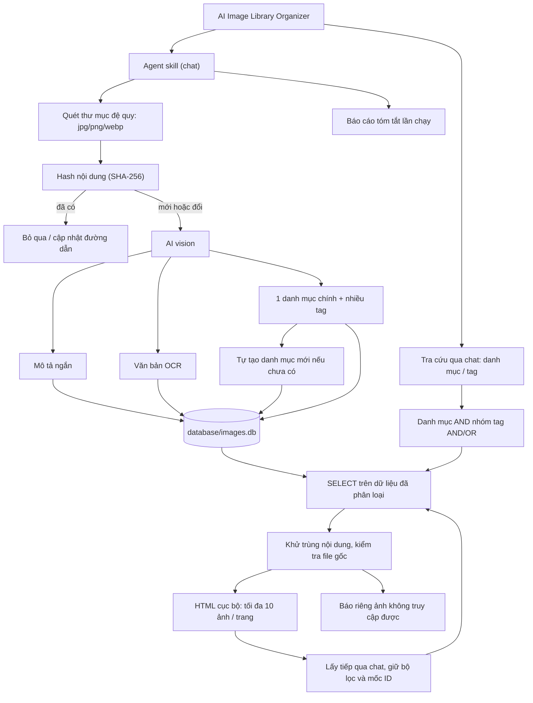
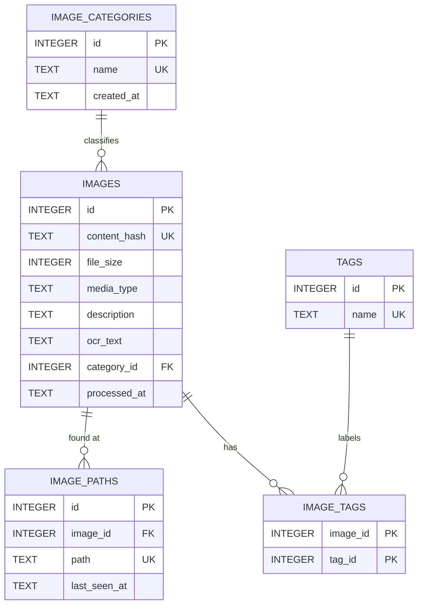

# AI Image Library Organizer

> Agent skill quét một thư mục ảnh, dùng AI vision để mô tả, OCR, gán một danh mục chính cùng nhiều tag, rồi lưu vào SQLite và bỏ qua ảnh không đổi theo hash nội dung. Người dùng có thể tra cứu ảnh theo danh mục hoặc tag qua chat và nhận trang HTML dạng thư viện ảnh.

## Details

### Mục tiêu

Biến một thư mục ảnh/screenshot lộn xộn (ví dụ `upload/Screenshots/`) thành dữ liệu có cấu trúc và lấy lại ảnh theo danh mục hoặc tag bằng thư viện HTML. Mô tả và văn bản trong ảnh được lưu để tham khảo; tìm kiếm toàn văn chưa thuộc phạm vi chức năng tra cứu này.

### Cách hoạt động

1. Người dùng yêu cầu qua chat và chỉ định một thư mục.
2. Skill quét đệ quy các file `.jpg`, `.jpeg`, `.png`, `.webp`. File gốc chỉ được đọc, không di chuyển hoặc đổi tên.
3. Với mỗi file, tính hash nội dung (SHA-256). Nếu hash đã có trong DB thì bỏ qua (chỉ cập nhật `path` nếu file đã được chuyển chỗ).
4. Với ảnh mới hoặc đã đổi nội dung, AI vision sinh ra:
   - mô tả ngắn nội dung ảnh;
   - văn bản trong ảnh (OCR);
   - đúng 1 danh mục chính;
   - nhiều tag.
5. Danh mục chưa tồn tại được tạo tự động và dùng ngay; người dùng gộp hoặc đổi tên sau.
6. Kết quả được ghi tự động vào `database/images.db`, không cần người dùng xác nhận từng ảnh.
7. Cuối lần chạy, skill báo tóm tắt: số ảnh quét, bỏ qua, thêm mới, cập nhật, danh mục mới được tạo, và các file lỗi.

### Tra cứu ảnh theo danh mục và tag

Phần bổ sung đã được xác nhận về đặc tả; chưa triển khai skill/script tra cứu hoặc tạo HTML thực tế.

1. Người dùng yêu cầu qua chat, cung cấp một danh mục, một danh sách tag, hoặc cả hai. Nếu không có bộ lọc nào, hỏi lại thay vì xuất toàn bộ thư viện.
2. Chuẩn hóa tên bằng cách bỏ khoảng trắng đầu/cuối, gộp khoảng trắng liên tiếp và chuyển thành chữ thường, giữ dấu tiếng Việt. Khớp chính xác với tên đã chuẩn hóa trong database; không tự đoán từ đồng nghĩa hoặc bỏ qua bộ lọc không tồn tại. Khi không tìm thấy tên, đưa ra gợi ý từ danh mục/tag có sẵn để người dùng chọn lại.
3. Với nhiều tag, hỗ trợ hai chế độ: `AND` (phải có đủ mọi tag, mặc định) và `OR` (có ít nhất một tag). Nếu có danh mục, ảnh luôn phải thuộc danh mục đó và thỏa điều kiện của nhóm tag. Loại tag trùng lặp trước khi truy vấn.
4. Chỉ đọc dữ liệu đã phân loại bằng `SELECT` với tham số ràng buộc; không quét lại thư mục, không gọi AI vision để phân loại lại và không cập nhật database.
5. Sắp xếp theo `images.id DESC`. Ghi nhớ mốc `id` lớn nhất ở lần tìm đầu để ảnh mới thêm sau đó không chen vào các trang kế tiếp. Mỗi nội dung/hash chỉ xuất hiện một lần, dù có nhiều đường dẫn hoặc nhiều tag khớp.
6. Với mỗi ảnh phù hợp, kiểm tra các đường dẫn đã lưu theo thứ tự `image_paths.id ASC` và chọn đường dẫn đầu tiên còn là file đọc được. Nếu tất cả đường dẫn đều không truy cập được, báo riêng ảnh đó cùng các đường dẫn đã lưu, không xóa hoặc sửa bản ghi và không tính ảnh đó vào giới hạn 10 ảnh hiển thị.
7. Tạo HTML tĩnh tại `reports/image-search-<mã-lần-tìm>-page-<số>.html`; mã lần tìm phải duy nhất, không ghi đè tệp có sẵn. Mỗi trang hiển thị tối đa 10 ảnh truy cập được, gồm ảnh xem trước, mô tả, danh mục, tag và liên kết mở file gốc. Hiển thị bộ lọc, chế độ tag, số trang, trạng thái còn kết quả hay đã hết và các ảnh không truy cập được đã gặp khi lấy trang đó. Nếu không có kết quả, hiển thị trạng thái rỗng rõ ràng.
8. Dùng đường dẫn tương đối tính từ HTML tới ảnh gốc và mã hóa URL đúng cách. Escape mọi văn bản và thuộc tính HTML lấy từ database; không coi OCR, mô tả, tag hoặc tên tệp là mã HTML. Không sao chép, nhúng dữ liệu ảnh, di chuyển hay đổi tên ảnh gốc; không dùng tài nguyên mạng ngoài.
9. Trả liên kết HTML cho người dùng. Khi người dùng yêu cầu "lấy tiếp", dùng cùng bộ lọc, chế độ tag, mốc ID ban đầu và con trỏ của trang trước để tạo HTML mới cho trang tiếp theo. Đây là thao tác qua chat, không phải nút gọi database trong HTML; nếu mất ngữ cảnh phân trang, hỏi lại hoặc bắt đầu lần tìm mới, không đoán.

Ví dụ yêu cầu:

- "Lấy ảnh danh mục logistics, tag fsi và cấu hình" dùng `AND`.
- "Lấy ảnh có tag dhl hoặc tms" dùng `OR`.
- "Lấy tiếp" tiếp tục lần tìm trong cùng ngữ cảnh chat.

### Phạm vi bản đầu

- Hình thức: agent skill chạy qua chat.
- Một người dùng cá nhân, một cơ sở dữ liệu `database/images.db` tách biệt với `finance.db`.
- Chỉ ảnh `jpg/png/webp`; có quét thư mục con.
- Mỗi ảnh thuộc đúng một danh mục chính, có thể có nhiều tag.
- Chỉ lưu những thông tin đã chọn: mô tả, OCR, danh mục, tag. Không lưu độ tin cậy. Chỉ lưu metadata kỹ thuật tối thiểu phục vụ nhận diện (đường dẫn, hash, kích thước file).
- Tra cứu qua chat theo danh mục/tag, xuất thư viện HTML tĩnh cục bộ; mặc định 10 ảnh mỗi trang, hỗ trợ lấy trang tiếp theo.
- Chức năng tra cứu chỉ dùng dữ liệu hiện có; không lưu lịch sử tìm kiếm hoặc tạo bảng mới.

### Non-goals

- Không di chuyển, đổi tên hay xóa ảnh gốc.
- Không có bước duyệt từng ảnh trước khi lưu.
- Không hỗ trợ PDF, HEIC, GIF; không có GUI/web app hoặc máy chủ. HTML chỉ là tệp kết quả tĩnh để xem cục bộ.
- Không phát hiện ảnh gần giống (chỉ trùng nội dung chính xác theo hash).
- Không tìm kiếm toàn văn mô tả/OCR, tìm kiếm ngữ nghĩa hoặc khớp gần đúng tự động trong chức năng tra cứu này.
- Không xuất bản thư viện lên mạng, sao chép ảnh sang thư mục xuất hoặc tạo HTML tự chứa dữ liệu ảnh.

### Giả định

- Hash nội dung là khóa nhận diện ảnh; hai file trùng nội dung ở hai đường dẫn khác nhau được xem là một ảnh, các đường dẫn được lưu riêng.
- Ảnh bị xóa khỏi thư mục không tự động bị xóa khỏi DB trong bản đầu.
- Việc gộp/đổi tên danh mục được thực hiện sau bằng yêu cầu chat riêng.
- HTML tham chiếu file ảnh gốc và chỉ dùng cục bộ; gửi riêng HTML sang máy khác hoặc di chuyển ảnh có thể làm hỏng liên kết xem ảnh.
- Bộ lọc và trạng thái lấy trang tiếp theo chỉ tồn tại trong ngữ cảnh chat, không được lưu vào SQLite. Mốc ID ngăn ảnh mới chen vào nhưng không phải snapshot bất biến nếu nhãn hoặc file gốc thay đổi giữa các lượt.

### Câu hỏi mở

- Dùng mô hình vision nào và ảnh được gửi ra dịch vụ bên ngoài hay xử lý cục bộ (ảnh screenshot có thể chứa thông tin nhạy cảm)?
- Chiến lược chuẩn hóa tên danh mục/tag (chữ hoa/thường, tiếng Việt hay tiếng Anh, tránh trùng nghĩa) khi AI tự tạo.
- Xử lý ảnh đã bị xóa hoặc đổi tên khỏi thư mục: đánh dấu `missing` hay giữ nguyên.
- Giới hạn kích thước ảnh/số ảnh mỗi lần chạy để kiểm soát chi phí và thời gian.
- Ảnh cùng hash nhưng nằm ở nhiều đường dẫn: có cần bảng đường dẫn riêng (đề xuất bên dưới đã dùng `image_paths`) hay chỉ giữ đường dẫn gần nhất.

## Graph

Liên quan: [[AI Income and Expense Tracker]] (cùng dạng skill + SQLite; hóa đơn có thể là một danh mục ảnh nhưng luồng ghi tài chính nằm ngoài phạm vi này).

## Data Model

> Schema hiện có tại `database/images.db`, tách biệt với `database/finance.db`; đã kiểm tra chỉ đọc trước khi thiết kế phần tra cứu. Các bảng dưới đây được tái sử dụng nguyên trạng. Phần tra cứu là đề xuất hành vi, không tạo hoặc sửa database trong bước ghi ý tưởng này.

### Mô hình dữ liệu cho tra cứu

Không cần mô hình lưu trữ mới: dùng lại đầy đủ bảng, cột, khóa ngoại và index bên dưới. Không thêm bảng lịch sử, bộ lọc, kết quả tìm kiếm hay báo cáo HTML.

| Dữ liệu | Bảng/cột tái sử dụng | Vai trò |
| --- | --- | --- |
| Danh mục | `image_categories.id`, `name`; `images.category_id` | Một danh mục có nhiều ảnh; mỗi ảnh thuộc đúng một danh mục |
| Tag | `tags.id`, `name`; `image_tags.image_id`, `tag_id` | Quan hệ N:M, hỗ trợ lọc AND/OR qua bảng nối |
| Ảnh và thứ tự | `images.id`, `content_hash`, `description` | Nhận diện nội dung duy nhất, lấy mô tả và phân trang |
| File gốc | `image_paths.id`, `image_id`, `path` | Quan hệ 1:N; chọn một đường dẫn còn đọc được |

Index hiện có đủ cho bản đầu: `idx_images_category_id`, `idx_image_tags_tag_id`, `idx_image_paths_image_id`, khóa chính kép (`image_id`, `tag_id`) và các ràng buộc UNIQUE trên tên danh mục/tag, hash và đường dẫn. Chưa đề xuất index mới.

Tham số tạm thời, không phải cột SQLite:

- `category`: tên danh mục tùy chọn; `tags`: danh sách tag không trùng; ít nhất một trong hai phải có giá trị.
- `tag_mode`: `AND | OR`, mặc định `AND`; nhóm tag rỗng không áp dụng điều kiện tag khi đã có danh mục.
- `page_size`: mặc định 10 ảnh đọc được; `anchor_id`: mốc ID lớn nhất lúc bắt đầu; `cursor_id`: ID ứng viên cuối đã xét, gồm cả ảnh không còn file để không lặp lại cảnh báo ở trang sau.
- `search_id`, `page_number`: định danh lần tìm và số trang, chỉ để tạo tên HTML và tiếp tục trong ngữ cảnh chat.

Khi tạo kết quả, lọc ứng viên bằng mốc ID và con trỏ, dùng `EXISTS` hoặc truy vấn tổng hợp để tránh lặp ảnh do nhiều tag/đường dẫn. Với `AND`, đòi hỏi đủ số tag phân biệt đã yêu cầu; với `OR`, chỉ cần ít nhất một tag. Không dùng `LIMIT 10` trên các dòng JOIN trước khi khử trùng và kiểm tra file, vì có thể làm trang thiếu ảnh hợp lệ. Không ghi lại kết quả kiểm tra file hoặc thời gian truy cập vào database.

### `image_categories`

Danh mục chính của ảnh (AI tự tạo, người dùng gộp/đổi tên sau).

| Column | Type | Constraints | Description |
| --- | --- | --- | --- |
| `id` | INTEGER | PRIMARY KEY AUTOINCREMENT | Khóa thay thế |
| `name` | TEXT | NOT NULL UNIQUE | Tên danh mục (đã chuẩn hóa) |
| `created_at` | TEXT | NOT NULL DEFAULT CURRENT_TIMESTAMP | Thời điểm tạo, ISO-8601 |

### `images`

Một ảnh duy nhất theo hash nội dung.

| Column | Type | Constraints | Description |
| --- | --- | --- | --- |
| `id` | INTEGER | PRIMARY KEY AUTOINCREMENT | Khóa thay thế |
| `content_hash` | TEXT | NOT NULL UNIQUE | SHA-256 nội dung file |
| `file_size` | INTEGER | NOT NULL, CHECK (`file_size >= 0`) | Dung lượng file (byte) |
| `media_type` | TEXT | NOT NULL, CHECK (`media_type IN ('image/jpeg','image/png','image/webp')`) | MIME type |
| `description` | TEXT | NULL | Mô tả ngắn do AI sinh |
| `ocr_text` | TEXT | NULL | Văn bản trong ảnh; NULL hoặc rỗng nếu không có |
| `category_id` | INTEGER | NOT NULL, FK → `image_categories(id)` | Danh mục chính duy nhất |
| `processed_at` | TEXT | NOT NULL DEFAULT CURRENT_TIMESTAMP | Lần xử lý AI gần nhất |
| `created_at` | TEXT | NOT NULL DEFAULT CURRENT_TIMESTAMP | Thời điểm thêm vào DB |

**Indexes:** `idx_images_category_id` on (`category_id`).

### `image_paths`

Các đường dẫn đã thấy của một ảnh (cùng nội dung có thể ở nhiều chỗ).

| Column | Type | Constraints | Description |
| --- | --- | --- | --- |
| `id` | INTEGER | PRIMARY KEY AUTOINCREMENT | Khóa thay thế |
| `image_id` | INTEGER | NOT NULL, FK → `images(id)` ON DELETE CASCADE | Ảnh tương ứng |
| `path` | TEXT | NOT NULL UNIQUE | Đường dẫn tuyệt đối của file |
| `last_seen_at` | TEXT | NOT NULL DEFAULT CURRENT_TIMESTAMP | Lần cuối quét thấy |

**Indexes:** `idx_image_paths_image_id` on (`image_id`).

### `tags`

| Column | Type | Constraints | Description |
| --- | --- | --- | --- |
| `id` | INTEGER | PRIMARY KEY AUTOINCREMENT | Khóa thay thế |
| `name` | TEXT | NOT NULL UNIQUE | Tên tag (đã chuẩn hóa) |

### `image_tags`

Bảng nối N:M giữa ảnh và tag.

| Column | Type | Constraints | Description |
| --- | --- | --- | --- |
| `image_id` | INTEGER | NOT NULL, FK → `images(id)` ON DELETE CASCADE | Ảnh |
| `tag_id` | INTEGER | NOT NULL, FK → `tags(id)` ON DELETE CASCADE | Tag |

**Constraints:** PRIMARY KEY (`image_id`, `tag_id`). **Indexes:** `idx_image_tags_tag_id` on (`tag_id`).

### Relationships

- `image_categories` 1:N `images` (mỗi ảnh đúng 1 danh mục chính).
- `images` 1:N `image_paths`.
- `images` N:M `tags` qua `image_tags`.
- Quy tắc cập nhật: tìm theo `content_hash`; nếu có thì chỉ làm mới `image_paths.last_seen_at` (hoặc thêm đường dẫn mới); nếu chưa có thì chèn `images`, `image_paths`, các `tags` và `image_tags`.

## Related

- [[Idea Index]]
- [[AI Income and Expense Tracker]]
