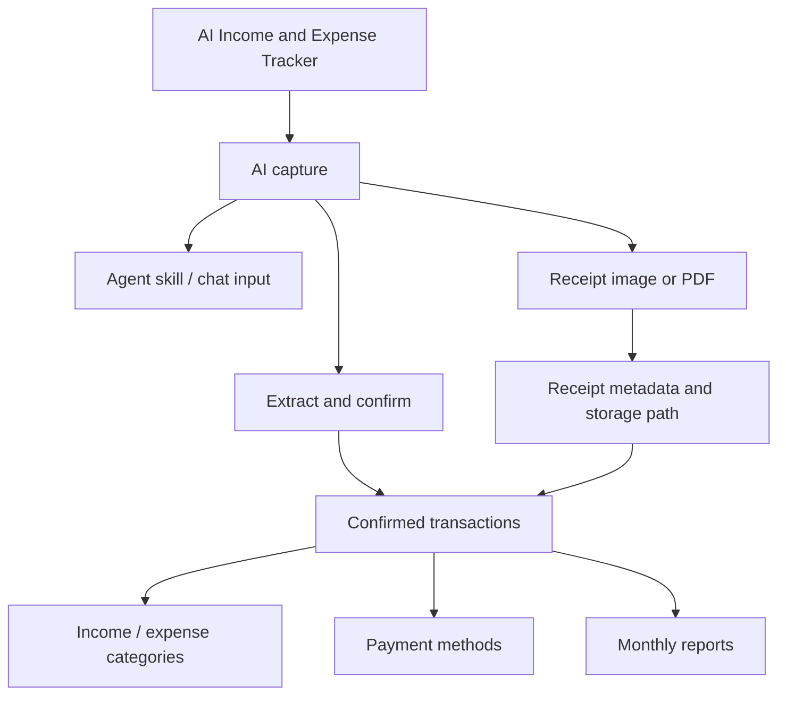
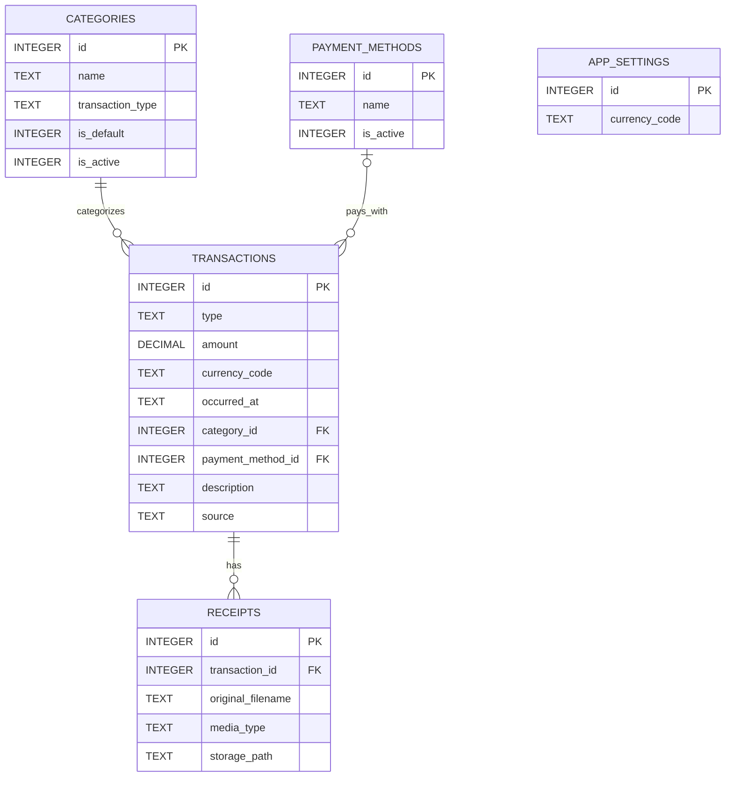

# AI Income and Expense Tracker

> Ứng dụng cá nhân giúp ghi nhận thu nhập và chi tiêu bằng AI qua chat hoặc hóa đơn ảnh/PDF, sau đó tổng hợp báo cáo từ đầu tháng. AI trích xuất giao dịch để người dùng kiểm tra và xác nhận trước khi lưu.

## Details

### Mục tiêu

Giúp một người dùng ghi chép thu nhập và chi tiêu dễ dàng hơn, đặc biệt khi không muốn nhập liệu thủ công. Người dùng có thể cung cấp nội dung qua AI skill dành cho agent hoặc tải ảnh/PDF hóa đơn. Sau khi trích xuất, thông tin giao dịch được hiển thị để người dùng xác nhận; chỉ giao dịch đã xác nhận mới được lưu chính thức.

### Phạm vi bản đầu

- Một người dùng cá nhân.
- Theo dõi cả thu nhập và chi tiêu.
- Giao dịch lưu số tiền, ngày/giờ, danh mục, ghi chú/đối tượng và phương thức thanh toán.
- Chọn một loại tiền tệ cho cấu hình ứng dụng; mỗi giao dịch vẫn lưu mã tiền tệ để bảo toàn ý nghĩa lịch sử.
- Danh mục có sẵn và cho phép người dùng tự tạo.
- Nhập bằng AI skill qua chat hoặc bằng ảnh/PDF hóa đơn.
- AI trích xuất giao dịch; người dùng xác nhận trước khi lưu.
- Mỗi hóa đơn tạo một giao dịch tổng, không tách thành các dòng mặt hàng.
- Người dùng nhập khoảng thời gian; báo cáo HTML gồm tổng thu, tổng chi, số dư ròng, biểu đồ, diễn giải, bảng theo danh mục và bảng giao dịch.
- Báo cáo phân tách theo tiền tệ, không cộng chéo các loại tiền. So sánh chi tiêu với cùng ngày tháng trước (hoặc tháng trước đầy đủ khi kỳ báo cáo là cả tháng).
- Lưu báo cáo tại `reports/` với tên tệp theo khoảng ngày; không ghi đè báo cáo đã có.

### Giả định và giới hạn

- Nội dung hội thoại thô không được lưu trong database; chỉ giao dịch đã xác nhận và metadata hóa đơn được lưu.
- Bản nháp AI trước khi xác nhận chỉ tồn tại tạm thời; chưa có chức năng lưu để tiếp tục sau.
- Tệp hóa đơn được lưu ở vùng lưu trữ ngoài database; database chỉ giữ đường dẫn và metadata.
- Vô hiệu hóa danh mục/phương thức thanh toán thay vì xóa bản ghi đã được giao dịch tham chiếu.
- Báo cáo được tính từ các giao dịch, không lưu thành bảng báo cáo riêng.

### Câu hỏi mở

- Chưa xác định chính sách lưu trữ, mã hóa và thời hạn xóa tệp hóa đơn.
- Chưa xác định trải nghiệm sửa giao dịch sau khi lưu và cách lưu vết lịch sử chỉnh sửa.

## Graph

## Data Model

> Implemented SQLite schema at `database/finance.db`. The `record-income-expense` skill writes confirmed transactions; the `expense-report` skill reads this schema to create period-based reports. Keep this note aligned with the live schema.

### `transactions`

One confirmed income or expense entry. Store the amount as a decimal value with exactly two digits after the decimal point.

| Column | Type | Constraints | Description |
| --- | --- | --- | --- |
| `id` | INTEGER | PRIMARY KEY AUTOINCREMENT | Transaction identifier |
| `type` | TEXT | NOT NULL, CHECK (`income` or `expense`) | Transaction kind |
| `amount` | DECIMAL(16,2) | NOT NULL, CHECK (`amount > 0 AND amount = ROUND(amount, 2)`) | Monetary amount with two digits after the decimal point |
| `currency_code` | TEXT | NOT NULL | ISO 4217 code; snapshot of the currency used |
| `occurred_at` | TEXT | NOT NULL | Transaction date/time in ISO 8601 format |
| `category_id` | INTEGER | NOT NULL, FK → `categories(id)` | Transaction category |
| `payment_method_id` | INTEGER | NULL, FK → `payment_methods(id)` | Cash, card, e-wallet, or other method |
| `description` | TEXT | NULL | Note, merchant, or counterparty |
| `source` | TEXT | NOT NULL, CHECK (`chat`, `receipt`, or `manual`) | How the transaction was entered |
| `created_at` | TEXT | NOT NULL DEFAULT CURRENT_TIMESTAMP | Record creation time |
| `updated_at` | TEXT | NOT NULL DEFAULT CURRENT_TIMESTAMP | Last update time |

**Indexes:** `idx_transactions_occurred_at` on (`occurred_at`), `idx_transactions_category_date` on (`category_id`, `occurred_at`), and `idx_transactions_type_date` on (`type`, `occurred_at`). These support monthly and category report queries.

**Validation:** The category's `transaction_type` must match the transaction's `type`; enforce this in application logic or with an appropriate database trigger.

### `categories`

Default and user-created income/expense categories. Keep used categories and mark them inactive instead of deleting them.

| Column | Type | Constraints | Description |
| --- | --- | --- | --- |
| `id` | INTEGER | PRIMARY KEY AUTOINCREMENT | Category identifier |
| `name` | TEXT | NOT NULL | Display name |
| `transaction_type` | TEXT | NOT NULL, CHECK (`income` or `expense`) | Which transaction kind can use this category |
| `is_default` | INTEGER | NOT NULL DEFAULT 0, CHECK (0 or 1) | Whether the category is app-provided |
| `is_active` | INTEGER | NOT NULL DEFAULT 1, CHECK (0 or 1) | Whether users can select it for new transactions |
| `created_at` | TEXT | NOT NULL DEFAULT CURRENT_TIMESTAMP | Record creation time |

**Constraints and indexes:** `UNIQUE(name, transaction_type)`; `idx_categories_type_active` on (`transaction_type`, `is_active`).

### `payment_methods`

Reusable payment methods referenced by transactions. Deactivate a method rather than deleting one already in use.

| Column | Type | Constraints | Description |
| --- | --- | --- | --- |
| `id` | INTEGER | PRIMARY KEY AUTOINCREMENT | Payment method identifier |
| `name` | TEXT | NOT NULL UNIQUE | Display name, such as cash, card, or e-wallet |
| `is_active` | INTEGER | NOT NULL DEFAULT 1, CHECK (0 or 1) | Whether users can select it for new transactions |
| `created_at` | TEXT | NOT NULL DEFAULT CURRENT_TIMESTAMP | Record creation time |

### `receipts`

Metadata for uploaded receipt files. File contents live in external storage; one transaction may have multiple receipt files.

| Column | Type | Constraints | Description |
| --- | --- | --- | --- |
| `id` | INTEGER | PRIMARY KEY AUTOINCREMENT | Receipt identifier |
| `transaction_id` | INTEGER | NOT NULL, FK → `transactions(id)` ON DELETE CASCADE | Transaction represented by the receipt |
| `original_filename` | TEXT | NOT NULL | Uploaded file name |
| `media_type` | TEXT | NOT NULL, CHECK (`media_type GLOB 'image/*'` or `media_type = 'application/pdf'`) | File MIME type |
| `storage_path` | TEXT | NOT NULL | Reference to the externally stored file |
| `uploaded_at` | TEXT | NOT NULL DEFAULT CURRENT_TIMESTAMP | Upload time |

**Indexes:** `idx_receipts_transaction_id` on (`transaction_id`).

### `app_settings`

Single-row application preferences, including the currently selected currency. Historical transactions keep their own currency code.

| Column | Type | Constraints | Description |
| --- | --- | --- | --- |
| `id` | INTEGER | PRIMARY KEY, CHECK (`id = 1`) | Enforces a single settings row |
| `currency_code` | TEXT | NOT NULL | Selected ISO 4217 currency code |

### Relationships and report queries

- `categories` 1:N `transactions`.
- `payment_methods` 1:N `transactions` (a transaction may have no method).
- `transactions` 1:N `receipts`.
- No separate report table is needed. Aggregate confirmed transactions by `occurred_at`, `type`, and category. For month-to-date comparison, compare the current month through the selected date with the same date range in the previous month.

## Related

- [[Idea Index]]
