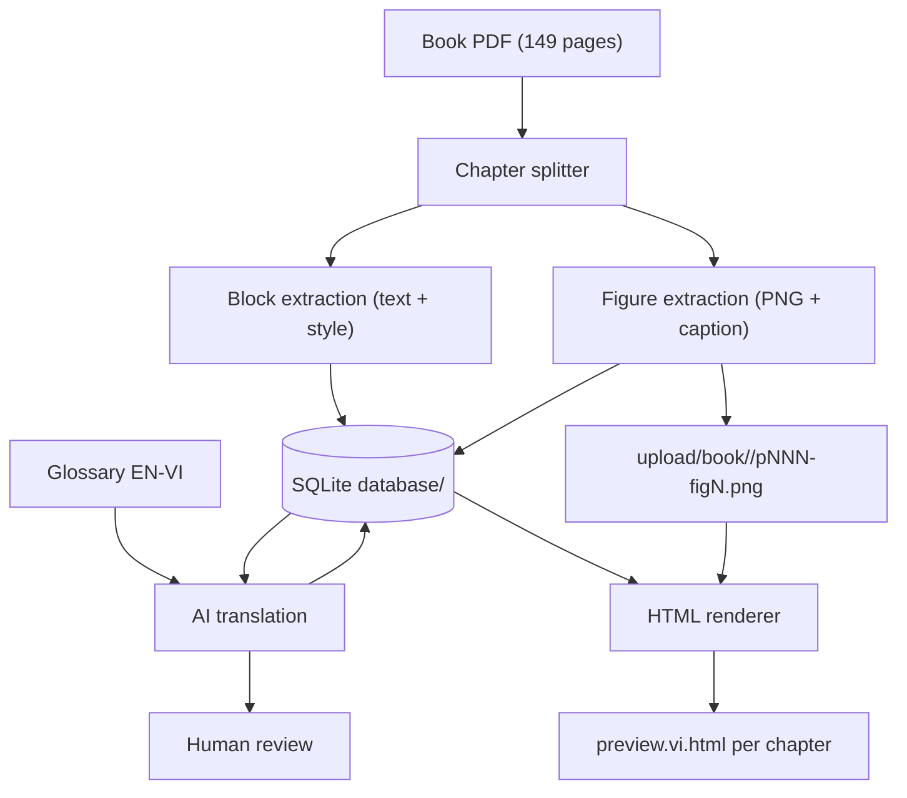
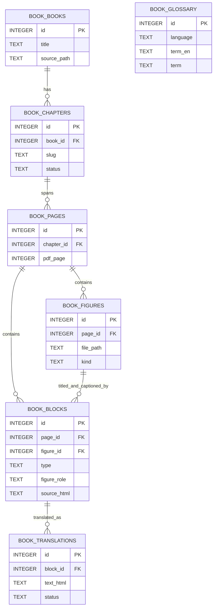

# PDF Book Extraction and Translation Reflow

> Trích xuất nội dung, hình ảnh và cấu trúc trình bày của sách PDF (ESMO Essentials for Clinicians – Breast Cancer, 2nd Ed.) vào SQLite, dịch sang tiếng Việt và dựng lại HTML giữ bố cục tương đương bản gốc, theo từng chương.

## Details

**Nguồn:** `upload/2024 ESMO Essentials for Clinicians Breast Cancer 2nd Edition ... .pdf` — 149 trang A4, có text layer, font Helvetica Neue nhúng, không có tag cấu trúc, hình là ảnh nhúng (JPEG xám/màu).

**Vấn đề:** Cần đọc sách bằng tiếng Việt nhưng vẫn giữ cách trình bày (heading, 2 cột, callout, caption, vị trí hình, màu nhấn) để dễ đối chiếu với bản gốc.

**Hướng tiếp cận (pipeline theo chương):**

1. **Phân chương:** lấy mục lục/bookmark để chia sách thành chapter và dải trang.
2. **Trích xuất text có cấu trúc:** theo từng trang, gom ký tự thành *block* (heading, paragraph, list item, callout, caption, footnote, table). Ghi kèm style: cỡ chữ, đậm/nghiêng, màu, cột, thứ tự đọc. Các đoạn nhấn mạnh trong câu được đánh dấu bằng thẻ span (`<s1>…</s1>`) như bản thử hiện có.
3. **Trích xuất hình:** dùng `pdfimages`/render vùng hình, lưu `pNNN-figN.png` trong `upload/book/<chapter-slug>/`, ghi vị trí (trang, cột, thứ tự) và caption liên kết.
4. **Dịch:** AI dịch từng block (source → translated) với glossary Anh–Việt để nhất quán thuật ngữ y khoa; giữ nguyên các thẻ span. Mỗi bản dịch có trạng thái review.
5. **Dựng HTML:** sinh `preview.vi.html` theo chương từ DB (CSS cố định: trang 595pt, lưới 2 cột, callout, figure/figcaption, footer).

**Hiện trạng:** Chương 1 (PDF trang 16–23) đã được trích xuất vào `database/books.db` (schema bên dưới, tạo bằng skill `extract-book-chapter` tại `.agents/skills/extract-book-chapter/`) và dịch sang tiếng Việt (`vi`) và tiếng Trung (`zh`), ảnh lưu ở `upload/book/<slug>/`, HTML ở `preview.html`, `preview.vi.html`, `preview.zh.html`. `database/book.db` là DB của bản thử cũ (schema khác), được giữ nguyên.

**Mô hình hình (đã chốt):** mỗi hình trong sách là một khung hồng gắn nhãn `Fig. N`, gồm ba loại chữ khác nhau:

1. **Tiêu đề hình** (`figure_role = title`): nằm *phía trên* ảnh, căn giữa. Hiển thị lại phía trên ảnh đúng như sách.
2. **Chú thích riêng từng ảnh con / điểm chỉ** (`annotation`): ví dụ hai nhãn của hình 1.1, các bong bóng của hình 1.6. Mỗi chú thích là một mục riêng có vị trí và bản dịch riêng; bản dịch được đặt chồng lên ảnh đúng vị trí gốc (ảnh được xuất sau khi xóa chữ gốc, bong bóng vẫn giữ).
3. **Chú thích dưới ảnh** (`caption`): các dòng nhỏ như danh sách viết tắt, hiển thị dưới ảnh.

`Fig. N` và chữ cái A–D nằm trong ảnh, không dịch. Hình không có ảnh nhúng (`kind = vector`, ví dụ hộp "The triple test approach") được xuất thành ảnh và không dịch chữ bên trong.

**Giả định:**

- Chỉ dùng cá nhân/local, không đăng công khai (sách có bản quyền).
- PDF có text layer nên không cần OCR.
- "Giữ bố cục" nghĩa là giữ cấu trúc ngữ nghĩa (heading, đoạn, bảng, caption, vị trí hình), không phải tọa độ từng pixel.

**Ngoài phạm vi:** OCR, khớp tọa độ tuyệt đối, xuất bản/chia sẻ lại sách, dịch audio/video.

**Câu hỏi còn mở:**

- Bảng (table) trích bằng heuristic hay chụp thành ảnh khi quá phức tạp? (chương 1 chưa có bảng)
- Công thức, ký hiệu đặc biệt, hình vector xử lý thế nào ngoài việc xuất thành ảnh?
- Quy ước review: ai duyệt và tiêu chí chuyển trạng thái `machine → reviewed`?
- Chữ trong hình vector và chữ cái A–D có cần dịch/vẽ lại không (hiện để nguyên)?
- Bản dịch chú thích dài hơn bong bóng gốc: co chữ hay phóng bong bóng?
- Đường chú thích/đầu nối của callout bên cạnh đôi khi lọt vào mép ảnh hình.

## Graph

Liên quan: [[Idea Index]], [[AI Income and Expense Tracker]] (cùng dùng SQLite trong `database/`).

## Data Model

> Schema SQLite đã triển khai trong `database/books.db` (nguồn: `.agents/skills/extract-book-chapter/scripts/schema.sql`). `database/book.db` là DB của bản thử cũ với schema khác nên không dùng. Tiền tố `book_` tránh va chạm với các bảng tài chính.

### `book_books`

Một cuốn sách nguồn.

| Column | Type | Constraints | Description |
| --- | --- | --- | --- |
| `id` | INTEGER | PRIMARY KEY AUTOINCREMENT | Surrogate key |
| `title` | TEXT | NOT NULL | Tên sách |
| `source_path` | TEXT | NOT NULL UNIQUE | Đường dẫn PDF |
| `source_sha256` | TEXT | NOT NULL | Phát hiện PDF thay đổi |
| `page_count` | INTEGER | NOT NULL | Số trang PDF |
| `created_at` | TEXT | NOT NULL DEFAULT CURRENT_TIMESTAMP | ISO-8601 |

### `book_chapters`

| Column | Type | Constraints | Description |
| --- | --- | --- | --- |
| `id` | INTEGER | PRIMARY KEY AUTOINCREMENT | Surrogate key |
| `book_id` | INTEGER | NOT NULL, FK → `book_books(id)` | Sách |
| `number` | TEXT | | Số chương (null cho phần không đánh số) |
| `slug` | TEXT | NOT NULL | Tên thư mục ảnh/output |
| `title` | TEXT | NOT NULL | Tiêu đề gốc (bản dịch nằm ở block `chapter_title`) |
| `start_page` | INTEGER | NOT NULL | Trang PDF bắt đầu |
| `end_page` | INTEGER | NOT NULL | Trang PDF kết thúc |
| `status` | TEXT | NOT NULL DEFAULT 'extracted' | Tiến độ pipeline |

**Indexes:** `UNIQUE(book_id, slug)`; `idx_book_chapters_book` on (`book_id`, `start_page`).
**Enumerations:** `status` ∈ `extracted | translated | reviewed | rendered`

### `book_pages`

| Column | Type | Constraints | Description |
| --- | --- | --- | --- |
| `id` | INTEGER | PRIMARY KEY AUTOINCREMENT | Surrogate key |
| `chapter_id` | INTEGER | NOT NULL, FK → `book_chapters(id)` | Chương |
| `pdf_page` | INTEGER | NOT NULL | Số trang PDF (1-based) |
| `printed_page` | TEXT | | Số trang in trên sách |

**Indexes:** `UNIQUE(chapter_id, pdf_page)`.

### `book_blocks`

Đơn vị nội dung theo thứ tự đọc.

| Column | Type | Constraints | Description |
| --- | --- | --- | --- |
| `id` | INTEGER | PRIMARY KEY AUTOINCREMENT | Surrogate key (khớp `block:<id>`) |
| `page_id` | INTEGER | NOT NULL, FK → `book_pages(id)` | Trang |
| `seq` | INTEGER | NOT NULL | Thứ tự đọc trong trang |
| `col` | INTEGER | NOT NULL DEFAULT 0 | 0 = cột trái, 1 = cột phải, 2 = toàn chiều rộng |
| `y0` | REAL | NOT NULL | Tung độ trên cùng (sắp xếp xen kẽ với hình) |
| `type` | TEXT | NOT NULL | Loại block |
| `heading_level` | INTEGER | | 2–3 nếu là heading |
| `list_marker` | TEXT | | Ký hiệu đầu dòng |
| `figure_id` | INTEGER | FK → `book_figures(id)` | Hình mà block (tiêu đề/chú thích) thuộc về |
| `figure_role` | TEXT | CHECK ∈ `title \| annotation \| caption` | Vai trò trong hình |
| `translatable` | INTEGER | NOT NULL DEFAULT 1 | 0 với footer |
| `source_html` | TEXT | NOT NULL | Text gốc kèm span `<sN>`, `` |
| `style_json` | TEXT | | Font, cỡ chữ, màu cơ sở, màu nền callout, căn lề |
| `bbox_json` | TEXT | | [x0, y0, x1, y1] trên trang PDF (dùng để đặt chú thích chồng lên hình) |

**Indexes:** `UNIQUE(page_id, seq)`; `idx_book_blocks_type` on (`type`).
**Enumerations:** `type` ∈ `chapter_title | heading | paragraph | list_item | callout | caption | footnote | footer`

### `book_figures`

| Column | Type | Constraints | Description |
| --- | --- | --- | --- |
| `id` | INTEGER | PRIMARY KEY AUTOINCREMENT | Surrogate key |
| `page_id` | INTEGER | NOT NULL, FK → `book_pages(id)` | Trang |
| `seq` | INTEGER | NOT NULL | Thứ tự trong trang (figN) |
| `file_path` | TEXT | NOT NULL UNIQUE | `upload/book/<slug>/pNNN-figN.png` |
| `label` | TEXT | | Nhãn trong sách, ví dụ `Fig. 1.1` |
| `kind` | TEXT | NOT NULL DEFAULT 'raster' | `raster` (có ảnh nhúng) hoặc `vector` |
| `bbox_json` | TEXT | | Vùng cắt ảnh trên trang PDF [x0, y0, x1, y1] |
| `col` | INTEGER | NOT NULL DEFAULT 0 | 0 trái, 1 phải, 2 toàn chiều rộng |
| `y0` | REAL | NOT NULL | Tung độ trên cùng |
| `width_pt` | REAL | NOT NULL | Chiều rộng vùng cắt |
| `height_pt` | REAL | NOT NULL | Chiều cao vùng cắt |

**Indexes:** `UNIQUE(page_id, seq)`.
**Enumerations:** `kind` ∈ `raster | vector`

### `book_glossary`

| Column | Type | Constraints | Description |
| --- | --- | --- | --- |
| `id` | INTEGER | PRIMARY KEY AUTOINCREMENT | Surrogate key |
| `language` | TEXT | NOT NULL | Ngôn ngữ đích (`vi`, `zh`, …) |
| `term_en` | TEXT | NOT NULL | Thuật ngữ gốc |
| `term` | TEXT | NOT NULL | Bản dịch chuẩn |
| `abbr_en` | TEXT | | Viết tắt (BC, LN…) |
| `abbr` | TEXT | | Viết tắt trong ngôn ngữ đích (UTV, HBH…) |

**Indexes:** `UNIQUE(language, term_en)`.

### `book_translations`

| Column | Type | Constraints | Description |
| --- | --- | --- | --- |
| `id` | INTEGER | PRIMARY KEY AUTOINCREMENT | Surrogate key |
| `block_id` | INTEGER | NOT NULL, FK → `book_blocks(id)` | Block gốc |
| `language` | TEXT | NOT NULL DEFAULT 'vi' | Ngôn ngữ đích |
| `text_html` | TEXT | NOT NULL | Bản dịch, giữ nguyên span |
| `status` | TEXT | NOT NULL DEFAULT 'machine' | Trạng thái review |
| `model` | TEXT | | Mô hình/agent đã dịch |
| `updated_at` | TEXT | NOT NULL DEFAULT CURRENT_TIMESTAMP | ISO-8601 |

**Indexes:** `UNIQUE(block_id, language)`; `idx_book_translations_status` on (`status`).
**Enumerations:** `status` ∈ `machine | reviewed | rejected`

### Relationships

- `book_books` 1:N `book_chapters` 1:N `book_pages` 1:N `book_blocks` và `book_figures`.
- `book_blocks` 1:N `book_translations` (mỗi ngôn ngữ một bản).
- `book_blocks.figure_id` → `book_figures` (tiêu đề, chú thích riêng và chú thích dưới ảnh của hình; vai trò ở `figure_role`).
- `book_glossary` độc lập, lọc theo `language`, được dùng khi dịch.

## Related

- [[Idea Index]]
- [[AI Income and Expense Tracker]]
